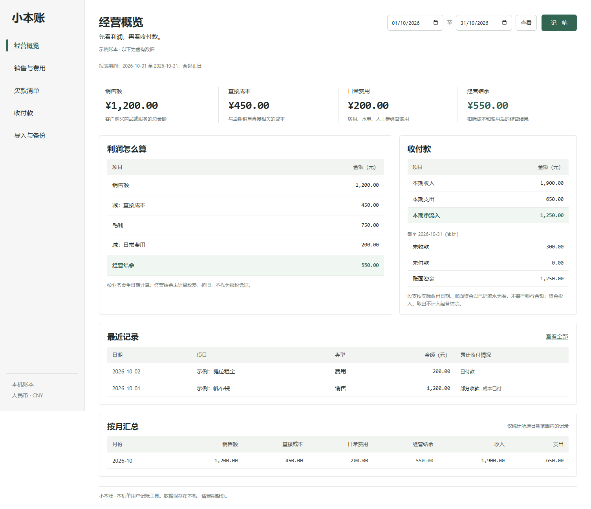
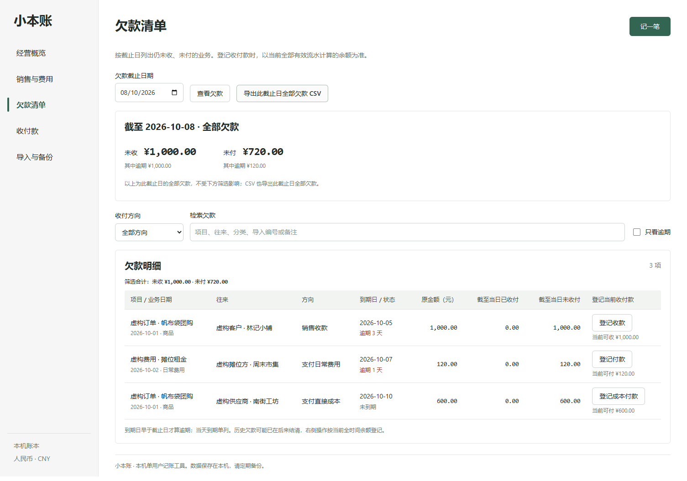

# 小本账

给小店和工作室用的本机经营账本。记下卖了多少、成本多少、花了哪些钱，再分别看经营结余和实际收付款。

[](https://github.com/SCUliujiacheng/small-business-ledger/actions/workflows/ci.yml) · [开始记账](docs/getting-started.md) · [计算口径](docs/design.md) · [接口与数据格式](docs/api-contract.md) · [安全边界](SECURITY.md)



## 先试一笔

25 个帆布袋，单价 48 元，单位直接成本 18 元，另有 200 元摊位费。

| 项目 | 计算 | 金额 |
| --- | --- | ---: |
| 销售额 | 25 × 48 | 1,200.00 元 |
| 直接成本 | 25 × 18 | 450.00 元 |
| 毛利 | 1,200 − 450 | 750.00 元 |
| 经营结余 | 750 − 200 | 550.00 元 |

如果只收到 900 元货款，未收款就是 300 元。补收这 300 元只改变收支，不会再增加一次销售额。

内置示例正是这组数据，还记了 1,000 元资金投入，以及 450 元成本付款和 200 元费用付款。因而示例的账面资金是 1,250 元，不是 550 元。初次启动不会自动填入示例；在「导入与备份」中手动载入，页面会一直标注“虚构数据”。

## 能做什么

- **记业务**：按件、单、次输入整数成交量、单价和单位直接成本；房租、人工、水电等单独记费用。
- **记收付款**：支持分次收款、分次付款。业务日期与收付日期分开，投入和取出资金不算经营收入或费用。
- **查结果**：自选日期范围，查看利润计算过程、月度汇总、截止日未收未付款和累计账面资金。
- **查欠款**：记客户、供应商和到期日，按截止日查看未收未付，筛选逾期款，并直接登记收付款。
- **改错**：作废后重记，保留原记录和原因。有收付款关联的业务，先作废相应流水。
- **搬数据**：CSV 预检后整批导入，导出业务和流水；JSON 完整备份，恢复时不覆盖已有账本。
- **防漏防重**：同一次保存失败重试沿用请求编号；非空账本每次修改前自动留存快照，保留最近 30 份。

所有账目写入本机 SQLite，不发到云端，也不调用大模型算账。

0.2 版补了欠款跟进、重复提交保护和自动备份；旧账本会先备份再升级，旧 CSV 和版本 1 JSON 仍可使用。[日常使用、升级和恢复方法](docs/getting-started.md)及[本次改动的具体口径](docs/daily-use.md)都单独写了说明。

<details>
<summary>欠款清单长什么样</summary>



同一笔销售的货款和成本付款分开列出。看历史日期时，右侧另显示现在还能收付多少。
</details>

## 本地运行

需要 Python 3.12、[uv](https://docs.astral.sh/uv/) 和 Node.js 22.12 或更新的 22.x 版本。

```sh
git clone https://github.com/SCUliujiacheng/small-business-ledger.git
cd small-business-ledger
uv sync --frozen --python 3.12
cd frontend
npm ci
npm run build
cd ..
uv run uvicorn small_business_ledger.app:create_app --factory --host 127.0.0.1 --port 8000
```

打开 **http://127.0.0.1:8000**。按 Ctrl+C 停止。之后可运行 Windows 的 `scripts/start.ps1` 或 macOS/Linux 的 `sh scripts/start.sh`。首次安装需要联网；安装和构建完成后，记账不依赖网络。

默认数据库是项目目录下的 `data/ledger.db`。可用环境变量 `LEDGER_DB_PATH` 指定另一份数据库；相对路径按启动目录解析。不要把数据库放进公开仓库。

<details>
<summary>前后端分开开发</summary>

后端仍在 8000 端口运行，设置 `LEDGER_DEV=1` 才允许本机 5173 端口的开发请求。

PowerShell：

```powershell
$env:LEDGER_DEV = '1'
uv run uvicorn small_business_ledger.app:create_app --factory --host 127.0.0.1 --port 8000 --reload
```

另一终端：

```sh
cd frontend
npm run dev
```

生产运行不需要也不应设置 `LEDGER_DEV`。
</details>

## 导入与备份

从页面下载 CSV 模板，使用 UTF-8 编码。`external_id` 是你为每笔业务保留的唯一编号；同一编号不能重复导入，作废也不会释放编号。每次最多 2,000 行、2 MiB。预检不写库，确认导入时会重新校验；任何一行失败，整批不写入。

CSV 适合录入和查阅，**不是完整备份**：不包含可恢复的收付款关联和完整作废历史。完整迁移请下载 JSON，恢复到一份没有任何记录的新数据库。包含作废记录的旧账本也不算空账本。

导出的 CSV 会转义可能被表格软件当作公式的文本，并用 `text_encoding=apostrophe-v1` 标记。导入时只还原带此标记的文本，不擅自删去普通 CSV 中的单引号。

备份没有加密，包含全部账目和备注。建议定期下载到另一处，并保留原始票据。

自动快照在数据库旁的 `<数据库文件名>.backups` 目录，只轮换工具生成的备份，保留最近 30 份。它保存的是修改前状态，不能替代关机前下载当前完整备份，也不能防同一硬盘损坏。目录不可写、备份校验失败或磁盘已满时，程序会阻止修改而不是跳过备份。恢复始终使用新空账本，操作步骤见[恢复说明](docs/getting-started.md#6-从备份找回)。

## 几个容易记错的地方

1. **直接成本不要重复记成费用。** 单位直接成本对应本次已售数量，不是整批进货款。
2. **利润不等于手头的钱。** 报表按业务发生日算经营结果，按实际收付日算收支。未收未付和账面资金是截至截止日的累计值；列表中的已收已付是全时间累计。
3. **作废不是退款。** 作废用于录入改错，会重算历史报告；本版没有退款业务和锁账功能。
4. **不要为了录入改日期。** 本版不支持预收预付、销售前已付的直接成本，也不管理库存。此类业务请使用更完整的会计或进销存软件。

## 这版的范围

这版适合在单机上试用日常经营记账，**不是正式会计或报税软件，也没有经过生产环境财务审计**。只支持人民币、整数数量，金额最多两位小数；整本账最多 10,000 条业务与流水（包含作废，导出不会释放容量）。一条销售只支持一个客户和一个成本收款方。金额不自动拆税，录入时需保持同一口径。

经营结余未自动计算税费、折旧等项目，不应当成法定净利润。账面资金只反映已记流水，不能替代银行对账。没有用户认证、多人权限、发票和防篡改凭证；请只在本机回环地址运行，不要开放公网。

## 实现与测试

React / TypeScript / Vite 做界面，FastAPI 提供接口，SQLite 保存数据。金额入参使用十进制字符串，服务器转成整数分；存储和报表计算不用浮点数。收付款余额检查和写入处于同一个 SQLite 写事务，避免同时提交时超额。

```sh
uv run pytest -q
uv run ruff check src tests
cd frontend
npm test
npm run build
npx playwright install chromium
npm run test:e2e
```

测试包含金额精度、跨月收款、亏损、并发超额付款、欠款截止日、作废约束、重复导入、恢复校验、跨站请求，以及浏览器里的录入与数据迁移。重复请求、备份刷盘失败、旧账本升级和备份轮换也有单独的回归测试。CI 在 Linux 跑完整流程，在 Windows 复测启动脚本和日常数据安全，并检查 Python 和前端依赖的已知漏洞。

基础财务概念参考 business.gov.au 的 [损益表](https://business.gov.au/finance/financial-tools-and-templates/set-up-a-profit-and-loss-statement) 与 [现金流](https://business.gov.au/finance/cash-flow/set-up-a-cash-flow-statement) 说明；项目使用自己的简化口径，不实现任何地区的税务规则。

MIT License。
